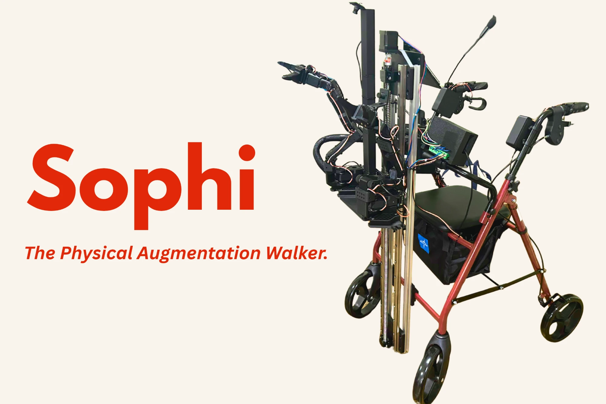

<p align="center">
  
</p>

<h3 align="center">The physical augmentation walker. Built at Cal Hacks 2026.</h3>

<p align="center">
  <a href="https://sophi.work"><b>Try the setup</b></a> ·
  <a href="#how-it-works">How it works</a> ·
  <a href="#under-the-hood">Under the hood</a> ·
  <a href="#run-it">Run it</a>
</p>

---

A walker holds you up, and that's all it does. If you drop your keys, they stay on the floor.

**Sophi adds the parts a walker is missing:** buttons and buzzers in the handles, sensors that notice what's in front of you, a voice you can talk to, and two robot arms on a lift. You only add the parts you need, and you choose them by telling Sophi about your day.

## How it works

**1. Say what you need.** Open [sophi.work](https://sophi.work) and type something like *"I keep bumping into things, small buttons are hard, and I'd like help picking things up."* Sophi asks a few short questions.

**2. Watch your walker draw itself.** As you answer, a pen-drawn walker sketches in each part Sophi suggests, along with the reason in your own words. Turn parts on or off, save it, and check out. Checkout is Stripe test mode, so no money moves.

**3. Use it.** Hold **Talk** on the handle and ask a question out loud. The walker answers through its speaker. When something gets close, the handles buzz.

## What's on the walker

| Part | What it does | Where it stands |
| --- | --- | --- |
| 🧭 **Setup** | Chat-based onboarding that suggests parts and explains why | ✅ Live at [sophi.work](https://sophi.work) |
| 🗣️ **Voice** | Hold Talk, ask anything, hear the answer | ✅ Spoken questions answered on the real Pi, about 4 s from release to reply |
| ✋ **Hand controls** | Big buttons and haptic buzzers in each handle | 🔧 Both boards talk to the Pi, and the press buzz has been felt |
| 📡 **Obstacle sensors** | Time-of-flight sensors that buzz the handles when something is near | 🔧 Two sensors read live distances, and the Pi has sent obstacle buzzes to the handles |
| 🦾 **Arms and lift** | Two SO-101 arms on a linear lift to reach the floor or a shelf | 🧪 Software tested against simulated motors. Not yet moving on the walker |
| 🆘 **Get help** | Hold both handle buttons to reach the people you trust | 🧪 Built and tested in the simulator |
| 🗺️ **Walking directions** | Spoken turn-by-turn directions | 🧪 Simulator only. No real GPS walk yet |

✅ works · 🔧 running on hardware, partly tested · 🧪 built, simulator only

## Under the hood

```text
  Web app ──────────► Cloud (sophi.work) ◄──────────► Raspberry Pi 5 ◄──── USB ────► ESP32 boards
  set up and           conversation, plans,             on the walker:               handles, buzzers,
  configure            your preferences                 buttons, voice,              obstacle sensors,
                                                        safety limits                lift
```

- **ESP32 boards** read the buttons and sensors and buzz the handles.
- **The Raspberry Pi** runs the walker. It listens, speaks, keeps track of every part, and enforces every motion limit.
- **The cloud** handles conversation and planning. It can suggest an action, but it can never move a motor, skip a stop, or silence an obstacle alert.
- **The web app** is where you set it up.
- **The voice is Cartesia's.** Hold Talk, and Cartesia's Ink speech-to-text turns what you say into words (built, not yet run live), Claude writes the answer, and Cartesia's Sonic voice speaks it. With no connection, the walker speaks in its own voice. Setup, the Cartesia features used and the known limits are in [Sophi and Cartesia](docs/demo/tracks.md#sophi-and-cartesia-the-readme-section-for-cartesias-judges).

A few rules we built around:

- **You choose.** Sophi asks about your tasks and preferences and never decides what you need from a diagnosis.
- **Safety stays local.** Stops and obstacle cues run on the walker itself and keep working offline.
- **Nothing moves without you.** Any arm or lift motion needs an explicit press from you, inside limits the Pi enforces.
- **Built for every way of using it.** The app is designed for keyboard, screen readers, large text and reduced motion, and nothing essential needs voice.
- **Private.** Voice clips are never stored, and conversations with the walker are deleted after an hour.

> [!NOTE]
> Sophi is a hackathon prototype. It isn't a certified mobility aid and it doesn't replace a caregiver.

## Run it

You'll need Node 22.12+ and pnpm 11 (`corepack enable` sets that up).

**The setup app** runs on <http://localhost:3000>. No keys are needed.

```bash
pnpm install
pnpm dev
```

**The walker, simulated on your laptop.** Press `t` to talk, `n` to put a hand in front of the sensor, and `?` for every key.

```bash
pnpm --filter @walker/pi bundle
node devices/pi/dist/walker.mjs simulate
```

More detail lives in the [web app](apps/web/README.md), [Pi service](devices/pi/README.md), [firmware](firmware/README.md), [architecture](docs/architecture.md) and [hardware](hardware/current-build.md) docs. If you're contributing, start with [AGENTS.md](AGENTS.md).
