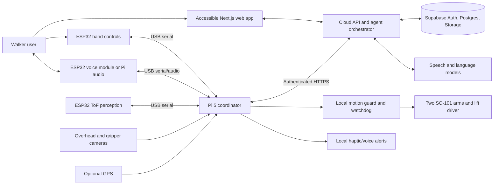

# System architecture

This is a proposed architecture for a Cal Hacks prototype, not an as-built schematic. It separates conversational intelligence from the controls that must respond immediately and reliably.

## End-to-end view

The cloud holds durable conversation state and makes task-level decisions. The Pi owns physical state and translates validated commands into device-specific actions. ESP32s own immediate sensor sampling, debouncing, local cues, and safe state on Pi disconnect. The web app owns onboarding, preferences, device management, and an accessible text path to the assistant.

## Component responsibilities

| Component | Owns | Must never own |
| --- | --- | --- |
| Web app | Accessible flows, consent, profile editing, module recommendations, settings, device pairing | Raw motor control or physical stop logic |
| Cloud API | Identity, agent loop, context retrieval, policy checks, task proposals, device command requests, audit trail | Direct serial access or sole safety enforcement |
| Pi runtime | USB discovery, command routing, sensor fusion for display, camera capture, motor guard, watchdog, offline behavior | Diagnosing a disability or trusting cloud output as an actuator command |
| Hand ESP32s | Buttons, trigger, haptics, health reports | Free-form agent logic |
| Perception ESP32 | ToF sampling, quality filtering, near-obstacle alerts, local haptic pattern request | Claims that a path is clear based only on sparse ToF sensors |
| Voice ESP32 | Button/mic/speaker transport if chosen | Keeping the only copy of a conversation or depending on cloud for a stop signal |
| Manipulation controller | Bounded task execution, kinematics, motion feedback, fault handling | Starting from an LLM sentence without a local guard and user signal |

## Important flows

### Onboarding and recommendation

1. Web app creates an authenticated session, or an ephemeral demo session with no durable sensitive profile.
2. User chooses text or speech and grants microphone permission only if needed. The agent asks about concrete tasks, environments, preferred feedback, and practical constraints. It should offer skip and edit controls.
3. Each turn is saved with a session ID. A structured profile summary is updated only after the user reviews it. The recommendation engine compares needs with a versioned module catalog and records evidence, uncertainty, prerequisites, and exclusions.
4. The web app shows each proposed module with a plain-language benefit, what it does not do, and an optionality toggle. The user confirms a device configuration; the cloud stores a versioned configuration for the Pi to fetch.

### Voice and assistant task

1. A hand button or other accessible control begins a voice turn; an audible/haptic cue confirms recording. Release/second press ends recording. A text input in the web app remains available.
2. The Pi records a bounded clip and uploads it over TLS. The cloud transcribes it, adds the current profile, device capability manifest, recent conversation, and *fresh* sensor snapshot to context, then runs the agent loop described in [cloud agents](subsystems/cloud-agents.md).
3. The assistant may answer, change a reversible setting, or propose a physical task. Physical tasks require a capability check, local validation, and user start/stop controls. The response returns text plus optional speech output; the Pi plays it if audio is enabled.
4. The Pi persists a small local queue of status events and syncs when connected. On network loss, it gives a clear offline message and continues local safety functions.

### Obstacle proximity

The perception ESP32 measures ToF sensors, rejects invalid/stale readings, and reports zones with timestamps. A conservative near-obstacle condition triggers local haptics through a direct ESP32 path or the Pi; the cloud is not in this loop. A haptic cue is advisory. The system must not claim collision avoidance or safe navigation until that behavior is actually validated with users and hardware.

### Manipulation

The assistant or user requests a high-level action such as “pick up the cup.” The Pi captures bounded camera frames and the manipulation planner proposes an object, grasp, and short motion plan. The user explicitly starts the action. The local motion guard checks available arm, homing state, workspace, lift position, velocity/force/current limits, timeout, collision zones, and current stop state. It executes a small segment, checks feedback, and can pause/replan. Emergency stop, user cancel, stale sensing, communication loss, or watchdog expiry stops motion. See [manipulation](subsystems/manipulation.md). The first version (proposed in [`motion.ts`](../packages/contracts/src/motion.ts), not built) has no camera planning: a person teaches a movement with a leader arm, and the walker replays it after a Confirm press; the lift runs on its own ESP32 (`lift-01`) with a watchdog and moves only while a person holds its control.

## Data and trust boundaries

- **Device identity:** each Pi has its own credential and capability manifest. A user's login cannot be used as the device credential. Pairing binds a device to an account and can be revoked.
- **User ownership:** profile, conversation, settings, and device records belong to a user/account. Authenticated endpoints and database policies enforce ownership. Caregiver access is a separate opt-in role, not a shared password.
- **Sensitive streams:** audio, frames, disability-related notes, and location have separate consent and short default retention. Do not use them for model training or share them with caregivers by default.
- **Agent output:** tools are allowlisted with typed inputs. Tool outputs and retrieved text are untrusted. The cloud decides whether a task is permitted; the Pi independently checks physical limits.
- **Network:** TLS, device authentication, request IDs, idempotency keys, bounded payloads, rate limits, and timeout/retry rules are required. Never put service credentials in the browser or firmware image.
- **Observability:** log request IDs, event types, tool decisions, stop reasons, and latencies. Redact transcripts, images, location, and access tokens from ordinary logs.

## Runtime states

The Pi starts in `booting`, discovers modules, performs health checks, and enters `ready` only when essential controls respond. Other states are `degraded` (a nonessential module fails), `offline` (cloud unavailable), `motion_active`, and `stopped` (user stop or fault). A stop is latched for actuators until a local reset and health check. Cloud reconnection never clears it. Sensor freshness is explicit: stale data is unknown, never “clear.”

## Deployment proposal

- `apps/web`: Next.js on Vercel; routes for onboarding, settings, and device management.
- `services/cloud-api`: authenticated request handlers for conversation and device turns. A long-lived experience is built from persisted sessions and event processing, rather than assuming one server process stays alive. Move lengthy work to a durable worker/queue if request limits become a problem.
- Supabase: Auth, Postgres, and private Storage. Use row-level security on exposed user tables, private buckets and signed access, and server-only elevated credentials.
- Pi: one supervised service with independently restartable module adapters. Local state contains configuration version, calibration, and a bounded offline event queue.
- ESP32: separate firmware targets sharing the versioned serial envelope.

The first implementation may combine web and cloud API in one Next.js project. Keep their modules and contracts distinct so they can be separated later without changing device interfaces.

## Related docs

- [Interfaces and message examples](interfaces.md)
- [Cloud agent design](subsystems/cloud-agents.md)
- [Hardware and power](subsystems/hardware-and-power.md)
- [Project stages and unresolved decisions](project-plan.md)
