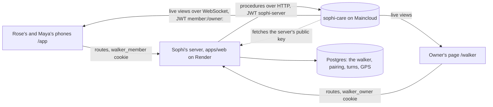

# care-db: the care circle on SpacetimeDB

A [SpacetimeDB](https://spacetimedb.com) module, in TypeScript, that holds Sophi's care circle: the phones linked to a walker, the one-time codes that add them, caretakers waiting for the owner's approval, the short messages between the phones, and the wrong-code tries. SpacetimeDB is a database that runs this code next to the data, so every change is one transaction, and the phones get each change pushed to them over a WebSocket the moment it commits. The contract (who calls what, the tokens, the views, the limits) is in [docs/interfaces.md, "The care circle on SpacetimeDB"](../../docs/interfaces.md#the-care-circle-on-spacetimedb-added-2026-10-24).

Built and tested on SpacetimeDB **2.13.0** (CLI and `spacetimedb` npm package).

## How it fits



- **The server writes; SpacetimeDB holds the circle.** `CircleService` (services/cloud-api) still checks every cookie, request and consent tick. Its store, `SpacetimeCircleStore`, calls one procedure per store step (`put_invite`, `claim_invite`, `approve_join`, `remove_member`, `save_message`, `circle_of`, `messages_for`, `member_by_secret`, `sweep_circle`, `forget_walker`, `ping`, and for help requests `ask_for_help`, `answer_help`, `help_of`). Each one returns its result as JSON; an expected "no" (a wrong code, a full circle) is a result, never an error.
- **The phones read live.** Each phone and the owner's page gets a one-hour token from the server and subscribes to its own views: `my_membership`, `my_people`, `my_messages`, `my_help` (one `{ help_id, rev }` row per help request of its walker; [help](../../docs/subsystems/help.md)) for a phone, `owner_members`, `owner_invites` for the owner's page. The tables are private; a view only ever returns the caller's own circle, never a cookie hash or a code's digits.
- **Who's who.** The server signs ES256 JWTs and publishes its public key at `/.well-known/openid-configuration` and `/.well-known/jwks.json`. SpacetimeDB checks the signature; the module checks the issuer, the audience `sophi-care` and the subject (`sophi-server`, `member:<id>`, `owner:<id>`). `configure` (run once by whoever published the database) sets the issuer it trusts.

## Files

- [`src/index.ts`](src/index.ts): the tables, the procedures, the views, the connect check and a sweep every minute.
- [`bindings/`](bindings/): the TypeScript client, generated by `spacetime generate` (`pnpm --filter @walker/care-db generate`). Imported as `@walker/care-db/bindings` by the phones (`apps/web/src/lib/careLive.ts`) and the tests. Regenerate after changing a view or a table a view returns.
- [`../../scripts/care-db.mjs`](../../scripts/care-db.mjs): `keygen` (the server's signing key) and `publish` (build, publish, configure).

## Run it locally

```bash
curl -sSf https://install.spacetimedb.com | sh
```

```bash
spacetime start --listen-addr 127.0.0.1:3010
```

Then, from the repository root, publish the module to that local server, trusting a local web server on port 3002:

```bash
node scripts/care-db.mjs publish --server http://127.0.0.1:3010 --database sophi-care --issuer http://127.0.0.1:3002
```

Make a settings file for the web app (it is ignored by git; the key is never printed):

```bash
printf "SPACETIME_URI=http://127.0.0.1:3010\nSPACETIME_DATABASE=sophi-care\nSPACETIME_ISSUER=http://127.0.0.1:3002\n" > apps/web/.env.care.local
```

```bash
node scripts/care-db.mjs keygen --out apps/web/.env.care.local
```

Run the web app with those settings on port 3002 (`set -a; . apps/web/.env.care.local; set +a` before `next dev --port 3002` or `next start`). `GET /api/v1/health` then answers `"care_db": "ok"`. Maincloud can't reach a localhost issuer, so local work always uses a local `spacetime start`.

To see two phones in one browser, give each its own host so their cookies stay apart, for example `http://127.0.0.1:3002/app` for Rose and `http://maya.localhost:3002/app` for Maya (browsers send `*.localhost` to this machine). Under `next dev`, Next.js refuses development assets on a host other than `localhost`, so use a production build (`next build`, then `next start`; it needs a `DATABASE_URL`, see the cloud-api README's "Testing against Postgres").

## Tests

With the local server running:

```bash
SPACETIME_TEST_SERVER=http://127.0.0.1:3010 pnpm --filter @walker/cloud-api test
```

- `test/walker/circle.test.ts` runs its 20 circle cases against `SpacetimeCircleStore` as well as memory and Postgres (each case publishes a fresh database).
- `test/walker/help.test.ts` runs the help cases against `SpacetimeCircleStore` too.
- `test/walker/care-db-views.test.ts` connects real WebSocket clients and checks the views (`my_help` included): no other circle's rows, a waiting caretaker's view turning to "member" on the same connection when approved, a message pushed within 2 s, removal emptying the views, the owner's views, and refusals (no token, a token signed with another key, a phone calling a server procedure).

Without `SPACETIME_TEST_SERVER` both skip with a message.

## Deploying (Maincloud and Render)

1. `spacetime login`, then publish to Maincloud, trusting the Render server:

   ```bash
   node scripts/care-db.mjs publish --server maincloud --database sophi-care --issuer https://steady-walker.onrender.com
   ```

2. Make the server's key: `node scripts/care-db.mjs keygen --out <a file outside git>`.
   The issuer stays `https://steady-walker.onrender.com` even though the site's main address is now `https://sophi.work`: both reach the same server, and a new issuer would mean running `configure` again.
3. On Render, add `SPACETIME_URI=https://maincloud.spacetimedb.com`, `SPACETIME_DATABASE=sophi-care`, `SPACETIME_ISSUER=https://steady-walker.onrender.com`, and the key as `SPACETIME_JWT_PRIVATE_KEY` (secret).
4. Deploy. Check `https://steady-walker.onrender.com/.well-known/openid-configuration` and `GET /api/v1/health` (`care_db: "ok"`).

Switching a running server to SpacetimeDB starts the circle empty: phones linked while the circle was in Postgres join again with new codes.

A changed module is published the same way. The help-request change (2026-10-24) only adds a table, procedures and a view, so it publishes over the existing database without `--delete-data` (checked on a local server: the 2026-10-24 module before help, then this one). Publish it before deploying a server that has the help routes: until then those routes answer `503` on a server with the `SPACETIME_*` settings. `spacetime publish` refuses a change that would need its data deleted unless given `--delete-data`, which empties the circle.

## Known limits

- **The circle and the walker live in two databases.** GPS sharing stays with the walker in Postgres (the heartbeat reads it). Turning it on checks her membership in SpacetimeDB, writes Postgres, and checks again. Removing her phone turns sharing off after SpacetimeDB commits; if that write failed, caretakers still don't see a position, because the phone's home shows one only while her phone is in.
- **If SpacetimeDB can't be reached:** phones and the owner's page can't load or change the circle (the routes answer `503`). The walker keeps working: health stays `200` (with `care_db: "unreachable"`), a turn waits at most 1.5 s for the circle and goes on without recipients, and the walker's sweep skips the circle (the module sweeps itself every minute).
- **SpacetimeDB fetches the server's key from the server.** While Render is starting or asleep, a new connection or call waits for it.
- **Phone tokens are visible to the page's scripts** (unlike the `httpOnly` cookie), so a script injected into the page could read one; each lasts an hour and can only read that phone's own views.
- **Orphans:** a circle whose walker was never forgotten but whose walker store was wiped (for example a memory store restarted) stays until its rows expire; approved phones don't expire. No such case arises on Render, where both stores persist.
- **Log noise:** every procedure call over HTTP logs `External attempt to call nonexistent reducer ...` in `spacetime logs` on 2.13.0, though the procedure runs and answers. A refused call answers `500` ("fatal error") from a procedure and `403` from the connect check.
